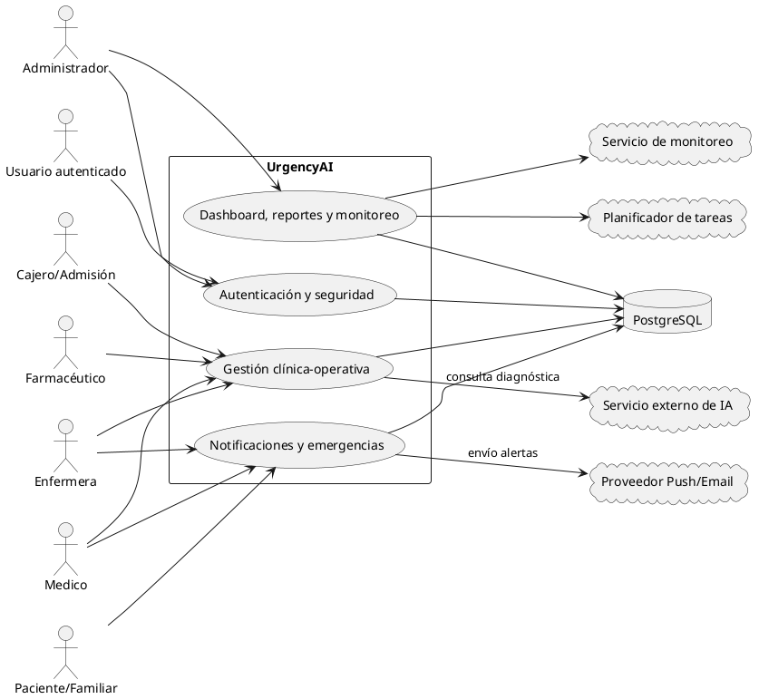

# Especificación UML – UrgencyAI: Sistema de Gestión de Sala de Urgencias con IA

**Versión:** 1.0  
**Fecha:** 2026-10-22  
**Proyecto:** UrgencyAI

## Índice

1. [Introducción y alcance](#1-introducción-y-alcance)
2. [Inventario ordenado de actores y roles](#2-inventario-ordenado-de-actores-y-roles)
3. [Trazabilidad de actores con HU-01 a HU-28](#3-trazabilidad-de-actores-con-hu-01-a-hu-28)
4. [Vista de contexto](#4-vista-de-contexto)
5. [Vista funcional por paquetes de casos de uso](#5-vista-funcional-por-paquetes-de-casos-de-uso)
6. [Vista lógica (diagrama de clases)](#6-vista-lógica-diagrama-de-clases)
7. [Relaciones UML <<include>> y <<extend>> recomendadas](#7-relaciones-uml-include-y-extend-recomendadas)
8. [HU-28 como requisito no funcional transversal](#8-hu-28-como-requisito-no-funcional-transversal)
9. [Recomendaciones para construcción de diagramas](#9-recomendaciones-para-construcción-de-diagramas)
10. [Anexo: código PlantUML](#10-anexo-código-plantuml)

---

## 1. Introducción y alcance

Este documento define la especificación UML integral de **UrgencyAI**, alineada exclusivamente con:

- `docs/historias-de-usuario.md` (HU-01 a HU-28).
- `docs/requisitos.md` (RF-01 a RF-28 y RNF-01 a RNF-20).
- `README.md` (roles, stack y alcance general).

El alcance UML cubre:

- Actores internos y externos del ecosistema de urgencias.
- Frontera del sistema y relaciones principales.
- Paquetes funcionales con casos de uso.
- Modelo lógico de clases con énfasis en la entidad central **Atencion**.
- Reglas de trazabilidad entre historias de usuario y componentes funcionales.

No se introducen requisitos nuevos ni se altera el contenido funcional de las historias existentes.

---

## 2. Inventario ordenado de actores y roles

| Orden | Actor / Rol | Tipo | Responsabilidad principal |
|---:|---|---|---|
| 1 | Usuario autenticado (actor general) | Interno | Operaciones comunes de sesión, navegación y configuración personal |
| 2 | Administrador | Interno | Gestión de usuarios, auditoría, reportes, dashboard y monitoreo |
| 3 | Cajero / Admisión | Interno | Registro, búsqueda y actualización administrativa de pacientes |
| 4 | Médico | Interno | Diagnóstico clínico, validación IA, emergencias y seguimiento |
| 5 | Enfermera | Interno | Registro de signos vitales, triaje y respuesta a alertas |
| 6 | Farmacéutico | Interno | Inventario de medicamentos, dosis e interacciones |
| 7 | Paciente / Familiar | Externo de negocio | Consulta del estado de atención |
| 8 | Servicio externo de IA | Sistema externo | Generación de diagnósticos sugeridos |
| 9 | Proveedor Push/Email | Sistema externo | Entrega de notificaciones y alertas |
| 10 | Base de datos PostgreSQL | Infraestructura externa | Persistencia transaccional y consultas |
| 11 | Servicio de monitoreo | Infraestructura externa | Métricas operativas, logs y salud del sistema |
| 12 | Planificador de tareas | Infraestructura externa | Ejecución periódica de procesos programados |

---

## 3. Trazabilidad de actores con HU-01 a HU-28

### 3.1 Matriz actor → historias de usuario

| Actor / Rol | Historias asociadas |
|---|---|
| Usuario autenticado (general) | HU-01, HU-02, HU-07, HU-19, HU-28 |
| Administrador | HU-03, HU-04, HU-05, HU-21, HU-25, HU-26, HU-27 |
| Cajero / Admisión | HU-06, HU-08 |
| Médico | HU-08, HU-10, HU-14, HU-15, HU-16, HU-18, HU-20, HU-22 |
| Enfermera | HU-09, HU-10, HU-11, HU-17, HU-18, HU-22 |
| Farmacéutico | HU-12, HU-13, HU-14 |
| Usuario notificado (transversal operativo) | HU-23 |
| Paciente / Familiar | HU-24 |

### 3.2 Observación de consistencia

- HU-28 se mantiene trazada al actor general porque expresa expectativa de uso, pero se modela arquitectónicamente como **restricción transversal no funcional**.
- HU-23 se conserva como actor operativo genérico (“usuario notificado”), derivado de roles que reciben alertas.

---

## 4. Vista de contexto

### 4.1 Objetivo

Representar a UrgencyAI como sistema central de coordinación clínica-operativa para sala de urgencias, conectando personal de salud, administración y servicios tecnológicos externos.

### 4.2 Límite del sistema

Dentro del límite:

- Autenticación y autorización.
- Gestión de usuarios, pacientes, atenciones y signos vitales.
- Triaje, diagnóstico asistido por IA y validación médica.
- Farmacia, inventario y control de interacciones.
- Alertas, notificaciones, dashboard, reportes, auditoría y monitoreo operativo.

Fuera del límite:

- Servicio de IA tercero.
- Infraestructura de mensajería Push/Email.
- Proveedor/instancia de PostgreSQL.
- Plataforma externa de observabilidad/monitoring.
- Scheduler/orquestador de tareas.

### 4.3 Relaciones y flujos principales

1. Actores internos autentican y operan según rol.
2. Datos clínicos y administrativos se persisten en PostgreSQL.
3. Médico solicita diagnóstico asistido al servicio de IA y valida/descarta resultados.
4. Módulo de notificaciones distribuye eventos críticos vía proveedor Push/Email.
5. Servicio de monitoreo consume métricas, logs y eventos de estado.
6. Planificador ejecuta tareas recurrentes (p. ej., consolidaciones, alertas periódicas, mantenimiento).

---

## 5. Vista funcional por paquetes de casos de uso

### 5.1 Paquete: Autenticación y seguridad

Casos principales:

- Iniciar sesión (HU-01, RF-01).
- Cerrar sesión segura (HU-02, RF-02).
- Control por rol y sesiones (RNF-02, RNF-03, RNF-05).

### 5.2 Paquete: Gestión de usuarios

- Crear usuario (HU-03, RF-03).
- Editar usuario (HU-04, RF-04).
- Listar/buscar usuarios (HU-05, RF-05).

### 5.3 Paquete: Gestión de pacientes

- Registrar paciente (HU-06, RF-06).
- Buscar paciente (HU-07, RF-07).
- Editar datos de paciente (HU-08, RF-08).

### 5.4 Paquete: Clínica y signos vitales

- Registrar signos vitales (HU-09, RF-09).
- Visualizar historial clínico de signos (HU-10, RF-10).
- Editar signos vitales (HU-11, RF-11).

### 5.5 Paquete: Triaje

- Clasificar por nivel de urgencia (HU-17).
- Priorizar cola de atención por severidad.

### 5.6 Paquete: Diagnóstico asistido por IA

- Solicitar diagnóstico IA (HU-15, RF-17).
- Revisar sugerencias IA (HU-16, RF-18).
- Validar/rechazar diagnóstico IA (HU-20, RF-19, RF-20).

### 5.7 Paquete: Farmacia e inventario

- Gestionar medicamentos/stock (HU-12, RF-14, RF-15, RF-16).
- Registrar dosis dispensada (HU-13, RF-12).
- Verificar interacciones medicamentosas (HU-14, RF-13).
- Gestionar insumos médicos no farmacológicos (HU-21).

### 5.8 Paquete: Notificaciones y emergencias

- Recibir notificación de emergencia (HU-18, RF-21).
- Activar alerta de emergencia (HU-22).
- Responder a alerta (HU-23).
- Configurar preferencias de notificación (HU-19, RF-22).

### 5.9 Paquete: Asistencia al paciente

- Consultar estado de paciente (HU-24).

### 5.10 Paquete: Dashboard y reportes

- Ver dashboard principal (HU-25, RF-23, RF-28).
- Generar reportes (HU-26, RF-23, RF-24).

### 5.11 Paquete: Auditoría y monitoreo

- Auditoría de accesos (HU-27, RF-25).
- Monitorear estado del sistema (RF-26).
- Ejecutar optimizaciones (RF-27).

---

## 6. Vista lógica (diagrama de clases)

### 6.1 Principio estructural

La entidad **Atencion** se modela como núcleo transaccional porque vincula paciente, personal clínico, datos de triaje, evolución, diagnóstico y acciones terapéuticas.

### 6.2 Entidades principales

| Clase | Atributos clave | Relación esencial |
|---|---|---|
| Usuario | id, nombre, email, passwordHash, rol, activo | 1..* registros de auditoría |
| Paciente | id, cedula, nombreCompleto, fechaNacimiento, contactoEmergencia | 1..* atenciones |
| **Atencion** | id, fechaIngreso, estado, prioridadTriage, motivoConsulta | núcleo: compone signos, diagnóstico, alertas |
| SignoVital | id, fechaHora, temperatura, presionArterial, saturacionO2, frecuenciaCardiaca | *..1 atencion |
| DiagnosticoIA | id, sintomas, recomendaciones, confianza, estadoValidacion | *..1 atencion |
| ValidacionDiagnostico | id, decision, motivo, fechaHora | *..1 diagnosticoIA |
| Medicamento | id, nombre, stockActual, stockMinimo, fechaVencimiento | inventario farmacéutico |
| DosisDispensada | id, cantidad, viaAdministracion, observaciones, fechaHora | *..1 atencion, *..1 medicamento |
| AlertaEmergencia | id, codigo, nivel, estado, fechaActivacion | *..1 atencion |
| Notificacion | id, tipo, canal, mensaje, fechaEnvio, estadoEntrega | *..1 usuario |
| AuditoriaAcceso | id, accion, modulo, ip, fechaHora | *..1 usuario |
| Reporte | id, tipo, periodoInicio, periodoFin, formato, fechaGeneracion | generado por administrador |

### 6.3 Servicios de aplicación

- `AuthService`: login, logout, emisión/validación JWT.
- `PacienteService`: CRUD y búsqueda de pacientes.
- `AtencionService`: creación y transición de estado de atención.
- `TriajeService`: clasificación y priorización.
- `DiagnosticoIAService`: integración y gestión de sugerencias IA.
- `FarmaciaService`: stock, interacciones y dispensación.
- `NotificacionService`: en-app, push y email.
- `ReporteService`: agregaciones y exportación.
- `MonitoreoService`: salud de servicios y métricas.
- `AuditoriaService`: persistencia de eventos críticos.

### 6.4 Interfaces externas

- `IAProviderPort` → servicio externo de IA.
- `NotificationProviderPort` → proveedor Push/Email.
- `MonitoringPort` → plataforma de observabilidad.
- `TaskSchedulerPort` → planificador de tareas.
- `PacienteRepository`, `AtencionRepository`, etc. → PostgreSQL.

### 6.5 Enumeraciones sugeridas

- `RolUsuario = {ADMIN, CAJERO, MEDICO, ENFERMERA, FARMACEUTICO}`
- `NivelTriage = {ROJO, NARANJA, AMARILLO, VERDE, AZUL}`
- `EstadoAtencion = {EN_ESPERA, EN_TRIAGE, EN_ATENCION, FINALIZADA}`
- `CanalNotificacion = {IN_APP, PUSH, EMAIL}`
- `DecisionDiagnostico = {VALIDADO, DESCARTADO, PENDIENTE}`

---

## 7. Relaciones UML <<include>> y <<extend>> recomendadas

### 7.1 Relaciones <<include>>

- **Solicitar Diagnóstico IA** <<include>> **Registrar/Consultar Signos Vitales**.
- **Validar Diagnóstico IA** <<include>> **Revisar Sugerencia IA**.
- **Registrar Dosis** <<include>> **Verificar Interacciones**.
- **Activar Alerta de Emergencia** <<include>> **Notificar Equipo en Tiempo Real**.
- **Generar Reportes** <<include>> **Exportar Reportes** (variando formato).

### 7.2 Relaciones <<extend>>

- **Bloquear por intentos fallidos** <<extend>> **Iniciar Sesión**.
- **Responder a Alerta** <<extend>> **Recibir Notificación de Emergencia**.
- **Editar Signos Vitales** <<extend>> **Visualizar Signos Vitales** (corrección excepcional).
- **Optimización de rendimiento operacional** <<extend>> **Monitorear Estado del Sistema** (activación condicional por umbral).

---

## 8. HU-28 como requisito no funcional transversal

**HU-28 “Optimizar Rendimiento”** se modela como **restricción de calidad transversal** y no como caso de uso convencional por las razones siguientes:

1. No representa una interacción aislada con valor de negocio independiente.
2. Afecta el diseño de múltiples módulos (API, consultas, notificaciones, dashboard, integración IA).
3. Se alinea directamente con RNF de rendimiento y disponibilidad (RNF-07, RNF-08, RNF-09, RNF-11).

Tratamiento recomendado en UML:

- Documentar HU-28 en notas de arquitectura y en restricciones del modelo.
- Añadir estereotipos/constraints de rendimiento en componentes críticos.
- Trazar HU-28 a métricas de tiempo de respuesta y concurrencia.

---

## 9. Recomendaciones para construcción de diagramas

1. **Herramienta sugerida:** draw.io, StarUML, Visual Paradigm o PlantUML.
2. Mantener nomenclatura consistente (HU/RF/RNF) en notas de cada diagrama.
3. Usar paquetes por módulo para evitar saturación visual.
4. En casos de uso, separar actores internos y sistemas externos.
5. En clases, resaltar **Atencion** como agregador principal.
6. Usar colores por capa (dominio, aplicación, infraestructura).
7. Incorporar leyenda de estereotipos (`<<service>>`, `<<entity>>`, `<<port>>`).
8. Versionar diagramas junto con este documento para mantener trazabilidad.

---

## 10. Anexo: código PlantUML

### 10.1 Vista de contexto



### 10.2 Vista funcional (paquetes de casos de uso)

```plantuml
@startuml
left to right direction
skinparam packageStyle rectangle

actor Administrador
actor "Cajero/Admisión" as Cajero
actor Medico
actor Enfermera
actor "Farmacéutico" as Farma
actor "Usuario autenticado" as Usuario
actor "Paciente/Familiar" as PF
actor "Servicio IA" as IA
actor "Push/Email" as PUSH

package "Autenticación y seguridad" {
  usecase "Iniciar sesión" as UC1
  usecase "Cerrar sesión" as UC2
}

package "Gestión de usuarios" {
  usecase "Crear usuario" as UC3
  usecase "Editar usuario" as UC4
  usecase "Listar/Buscar usuarios" as UC5
}

package "Gestión de pacientes" {
  usecase "Registrar paciente" as UC6
  usecase "Buscar paciente" as UC7
  usecase "Editar datos del paciente" as UC8
}

package "Clínica y signos vitales" {
  usecase "Registrar signos vitales" as UC9
  usecase "Visualizar signos vitales" as UC10
  usecase "Editar signos vitales" as UC11
}

package "Triaje" {
  usecase "Clasificar por triaje" as UC17
}

package "Diagnóstico asistido por IA" {
  usecase "Solicitar diagnóstico IA" as UC15
  usecase "Revisar sugerencia IA" as UC16
  usecase "Validar diagnóstico IA" as UC20
}

package "Farmacia e inventario" {
  usecase "Gestionar medicamentos" as UC12
  usecase "Registrar dosis" as UC13
  usecase "Verificar interacciones" as UC14
  usecase "Gestionar insumos médicos" as UC21
}

package "Notificaciones y emergencias" {
  usecase "Configurar notificaciones" as UC19
  usecase "Recibir notificación" as UC18
  usecase "Activar alerta" as UC22
  usecase "Responder alerta" as UC23
}

package "Asistencia al paciente" {
  usecase "Consultar estado de paciente" as UC24
}

package "Dashboard y reportes" {
  usecase "Ver dashboard" as UC25
  usecase "Generar reportes" as UC26
}

package "Auditoría y monitoreo" {
  usecase "Auditoría de accesos" as UC27
}

Usuario --> UC1
Usuario --> UC2
Usuario --> UC7
Usuario --> UC19
Administrador --> UC3
Administrador --> UC4
Administrador --> UC5
Administrador --> UC21
Administrador --> UC25
Administrador --> UC26
Administrador --> UC27
Cajero --> UC6
Cajero --> UC8
Medico --> UC8
Medico --> UC10
Medico --> UC14
Medico --> UC15
Medico --> UC16
Medico --> UC18
Medico --> UC20
Medico --> UC22
Enfermera --> UC9
Enfermera --> UC10
Enfermera --> UC11
Enfermera --> UC17
Enfermera --> UC18
Enfermera --> UC22
Farma --> UC12
Farma --> UC13
Farma --> UC14
PF --> UC24
UC15 --> IA
UC18 --> PUSH

UC13 .> UC14 : <<include>>
UC20 .> UC16 : <<include>>
UC11 .> UC10 : <<extend>>
UC23 .> UC18 : <<extend>>
@enduml
```



### 10.3 Vista lógica (clases)

```plantuml
@startuml
skinparam classAttributeIconSize 0

class Usuario <<entity>> {
  +id: UUID
  +nombre: String
  +email: String
  +passwordHash: String
  +rol: RolUsuario
  +activo: Boolean
}

class Paciente <<entity>> {
  +id: UUID
  +cedula: String
  +nombreCompleto: String
  +fechaNacimiento: Date
  +contactoEmergencia: String
}

class Atencion <<entity>> {
  +id: UUID
  +fechaIngreso: DateTime
  +estado: EstadoAtencion
  +prioridadTriage: NivelTriage
  +motivoConsulta: String
}

class SignoVital <<entity>> {
  +id: UUID
  +fechaHora: DateTime
  +temperatura: Decimal
  +presionArterial: String
  +saturacionO2: Decimal
  +frecuenciaCardiaca: Int
}

class DiagnosticoIA <<entity>> {
  +id: UUID
  +confianza: Decimal
  +recomendaciones: Text
  +estadoValidacion: DecisionDiagnostico
}

class DosisDispensada <<entity>> {
  +id: UUID
  +cantidad: Decimal
  +viaAdministracion: String
  +fechaHora: DateTime
}

class Medicamento <<entity>> {
  +id: UUID
  +nombre: String
  +stockActual: Int
  +stockMinimo: Int
  +fechaVencimiento: Date
}

class AlertaEmergencia <<entity>> {
  +id: UUID
  +codigo: String
  +nivel: String
  +estado: String
}

class Notificacion <<entity>> {
  +id: UUID
  +tipo: String
  +canal: CanalNotificacion
  +estadoEntrega: String
}

class AuditoriaAcceso <<entity>> {
  +id: UUID
  +accion: String
  +modulo: String
  +ip: String
  +fechaHora: DateTime
}

class AuthService <<service>>
class AtencionService <<service>>
class DiagnosticoIAService <<service>>
class FarmaciaService <<service>>
class NotificacionService <<service>>
class ReporteService <<service>>

interface IAProviderPort <<port>>
interface NotificationProviderPort <<port>>
interface MonitoringPort <<port>>
interface TaskSchedulerPort <<port>>

enum RolUsuario { ADMIN; CAJERO; MEDICO; ENFERMERA; FARMACEUTICO }
enum NivelTriage { ROJO; NARANJA; AMARILLO; VERDE; AZUL }
enum EstadoAtencion { EN_ESPERA; EN_TRIAGE; EN_ATENCION; FINALIZADA }
enum CanalNotificacion { IN_APP; PUSH; EMAIL }
enum DecisionDiagnostico { VALIDADO; DESCARTADO; PENDIENTE }

Paciente "1" -- "0..*" Atencion
Atencion "1" -- "0..*" SignoVital
Atencion "1" -- "0..*" DiagnosticoIA
Atencion "1" -- "0..*" DosisDispensada
DosisDispensada "*" -- "1" Medicamento
Atencion "1" -- "0..*" AlertaEmergencia
Usuario "1" -- "0..*" Notificacion
Usuario "1" -- "0..*" AuditoriaAcceso

AuthService ..> Usuario
AtencionService ..> Atencion
DiagnosticoIAService ..> IAProviderPort
FarmaciaService ..> Medicamento
NotificacionService ..> NotificationProviderPort
ReporteService ..> MonitoringPort
ReporteService ..> TaskSchedulerPort
@enduml
```

---

**Fin del documento.**
